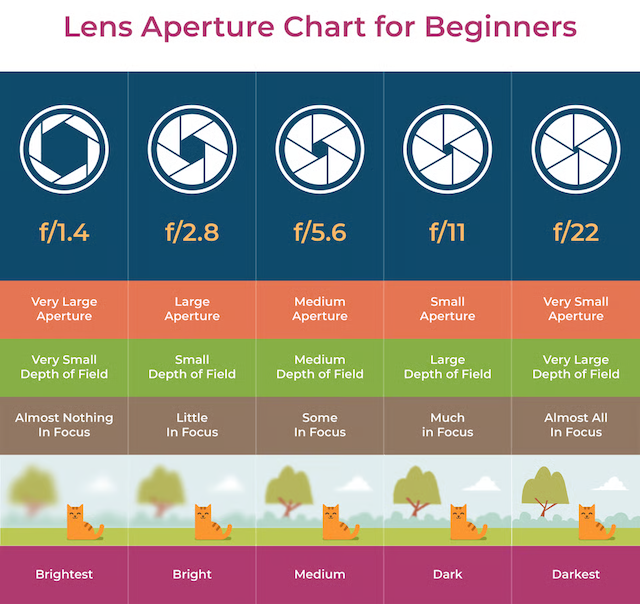

I find myself looking at flip phones whenever I visit an electronics shop. It's probably a good way to eliminate any chance of doom-scrolling. Or maybe I could make my own [Totally Spies Compowder](https://totallyspies.fandom.com/wiki/Compowder) (credit: [@sisiamara on Instagram](https://www.instagram.com/reel/DaYY8gaxMUW/)), which my inner child screams YES to.

"But Lily, you work in tech! You should be more tech-savvy and futuristic, not going backward," says a voice somewhere in my brain. But I just don't feel like it 😔. This conflict creates a self-doubting cycle and worries me a bit, so I start asking around to see what people think.

Turns out I'm not alone! In fact, everyone seems to be doing something similar already. People use film cameras instead of their phones, play vinyl records instead of streaming, journal in actual notebooks, and read actual books instead of e-books. Does this sound like you, too?

There seems to be a trend where we crave tangible experiences besides our mobile devices. After some research, I believe it has less about nostalgia and more about taking back our agency over what we’re exposed to.

===

## Our senses

"What's in my analog bag?" is trending these days, although I might not be fully analog with a Tamagotchi and a Nintendo DS. A neighbour told me she loves playing on a game console because pressing buttons just feels different from tabbing on screens. It makes sense, as buttons are textured while phones are usually a flat surface.

Being able to _touch_ and _interact_ with tangible materials reminds me where I am: the reality. Sometimes I get so into my head, so the smell and texture of papers remind me which world

connects us more to the virtual world behind the screens. It's not just a matter of usability, but also a bridge between the physical and virtual world.

It may be similar with books. The texture of the paper, the sound of a page turning and the smell of the book are irreplaceable by mobile devices.

---

It reminds me of a recent viral trend, "What's in my analog bag?" For my case, though, "tangible" might be a better word than "analog". When I talked about this with a neighbour, she told me she loves to play on a game console because pressing on buttons just feels good. That's probably why I got my Tamagotchi, too. Being able to _touch_ and interact with objects in real life feels different from tapping and sliding on a flat screen, even though they are digital objects.

It may be similar with books. The texture of the papers, the sound when I flip a page, and the smell of the books are irreplacable by mobile devices.

---

Vinyl is the same story. Picking a record in a store, placing it on the turntable and lowering the needle is a ritual that streaming doesn't have. Ownership plays a part as well. Some people say that's part of the appeal: a record on your shelf can't be edited or pulled from a platform at any point in the future.

---

Why are people going back in time? Are we repelling the advancement of technology? I personally think it might be the opposite

What if there's an aperture setting for our brain? How conscious are we at adjusting it?

I think the recent trend of going analog is an experiment to the "aperture setting" of our brain.

## What is aperture?

In short, "aperture" is a hole controlling the amount of light entering the camera. The bigger the hole is, the blurrer the background; the smaller the hole is, the clearer the background.

Source: [PhotographyLife | What is aperture in photography](https://photographylife.com/what-is-aperture-in-photography)

It is tricky to adjust, because it also affects brightness. Taking a good picture requires experimenting and finding the right balance.

## What is "going analog"?

I notice myself

We see from media videos like "What's in my analog bag"

Sometimes, I feel our mobile devices are turning the aperture setting to max all the time.
