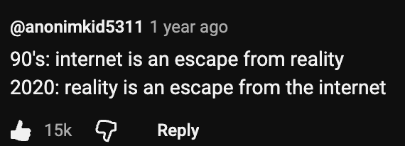

I find myself looking at flip phones whenever I visit an electronics shop. It's probably a good way to eliminate any chance of doom-scrolling. Or maybe I could make my own [Totally Spies Compowder](https://totallyspies.fandom.com/wiki/Compowder) (credit: [@sisiamara on Instagram](https://www.instagram.com/reel/DaYY8gaxMUW/)), which my inner child screams YES to.

"But Lily, you work in tech! You should be more tech-savvy and futuristic, not going backward," says a voice somewhere in my brain. But I just don't feel like it. This conflict creates a self-doubting cycle and worries me a bit, so I start asking around to see what people think.
Turns out I'm not alone! In fact, everyone seems to be doing something similar already. People use film cameras instead of their phones, play vinyl records instead of streaming, journal in actual notebooks, and read physical books instead of e-books. Does this sound like you, too?

There seems to be a trend where we crave tangible experiences over our mobile devices.
A neighbour told me about her love for Nintendo because pressing buttons just feels different from tapping on screens.
I totally agree. Sometimes I get too into my head, so being able to _touch_ and _interact_ with tangible materials becomes **the first step** to keeping me in the present. Our senses are our doors to the world.

But what kind of world are we interacting with? Is it the one where you need to find your daughter in a city full of monsters? Or the one full of glamorous stories from people you merely know, who just had a boat trip somewhere sunny and beautiful?

Engaging with tangible hobbies brings me to the present because it forces me to interact with my surroundings. Other than the music itself, for vinyl enthusiasts it's also about where they found the vinyl record, why they chose certain music, and who they share the story with while listening to the music together. These are all unique and personal experiences that are different from playing on a music streaming platform, and they give you reasons to visit places and talk to people instead of staying alone in your own room with a mobile device.

Why are people going back in time? Are we resisting the advancement of technology? I personally think it might be the opposite. It has less to do with nostalgia and more to do with taking back our agency over the world we're living in.

As Peter, the founder of a psychological social enterprise TreeholeHK, once said in an interview about the trend of confiding in AI:

> I think people are fundamentally social creatures. AI can never really replace the connection between people. Relying too much on AI in place of real relationships can actually leave you feeling even lonelier.

This hits me in the heart — as we get more information and ideas from our mobile devices, we are getting less from the world around us. Remember the scene from WALL-E where humans are sitting on chairs staring at screens? For me, using "old technologies" again is an attempt to reconnect with the real world around me, right here, right now. I don't want to end up like those people in the movie.

It's like photography. Aperture is the size of the hole that decides how much light is captured. You don't always need the max aperture size, and a good picture consists of a good balance with other settings, too. And the key to taking a good picture is _to notice your surroundings_. Being able to access all information around the world is not always the best, and life is not just about accessing information. Sometimes less is more.

With this reflection in mind, I feel less guilty about not being tech-savvy all the time. Creating my Totally Spies Compowder might be a great idea: I'd keep it to the essentials so I'm not tempted to reach for content. Now I'm curious — how do you stay grounded?

---

## Appendix

- A documentary about the trend of confiding in AI: [新聞透視｜與AI傾心事漸普及？研究：過度依賴或致用戶難容不同意見](https://www.youtube.com/watch?v=ug8zUzdJ518)

  - "我哋絕對唔希望有一啲用戶同我哋講 你哋個AI好正，我日日同佢傾偈，真人都唔洗見啦。 我覺得如果有人咁同我講，我會視為一個好失敗嘅comment。"
  - "我覺得人本身係一個好社交嘅動物。AI始終冇辦法取代人與人之間嘅connection。過分依賴AI取代人際關係反而會令人變得更加孤獨。"

- My neighbour shared a nice playlist with me about the trend: [Analog video essays Playlist](https://youtube.com/playlist?list=PLRO4nBKF3crA&si=RLC1flxAZs1-x-gf)
  - My favourite video: [Genuine Curiosity | Why Young People Love Old Things](https://youtu.be/0dEJiQnotR8?si=jFRM4OIumKtpNkoB)

    
