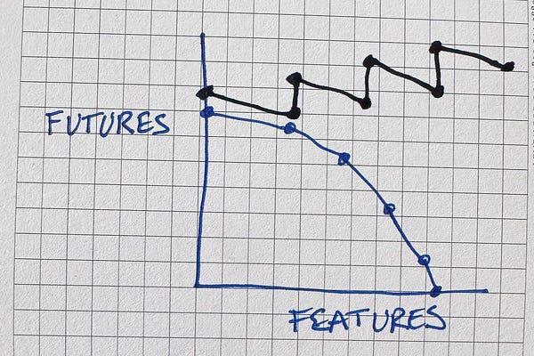
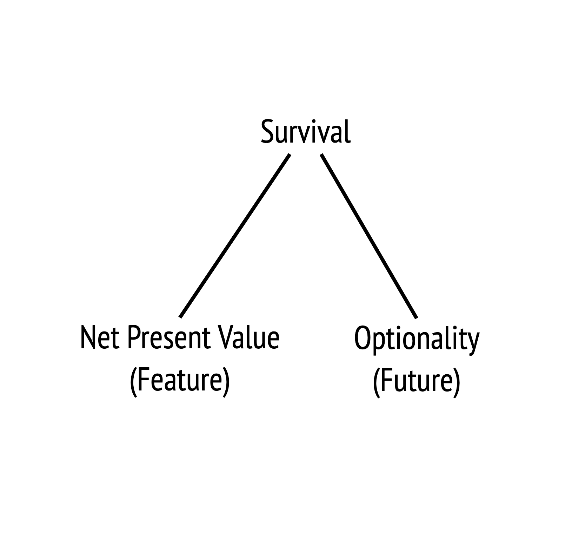
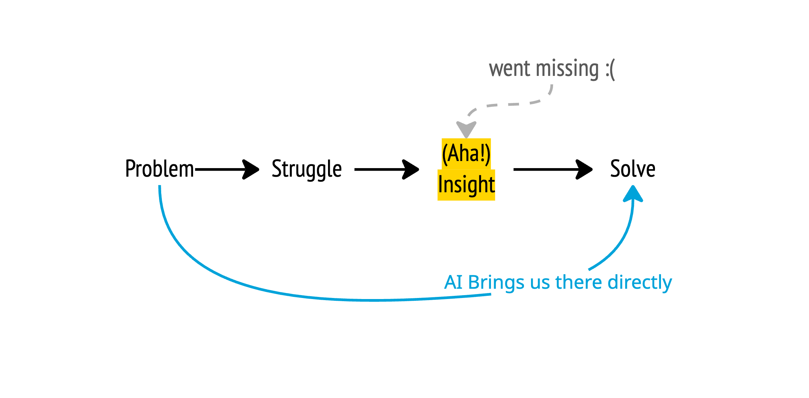
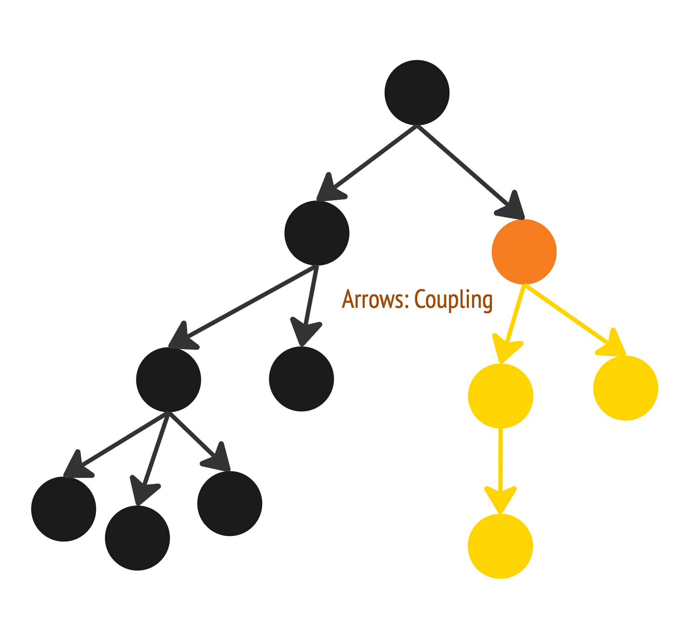
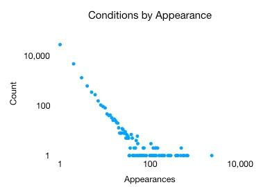
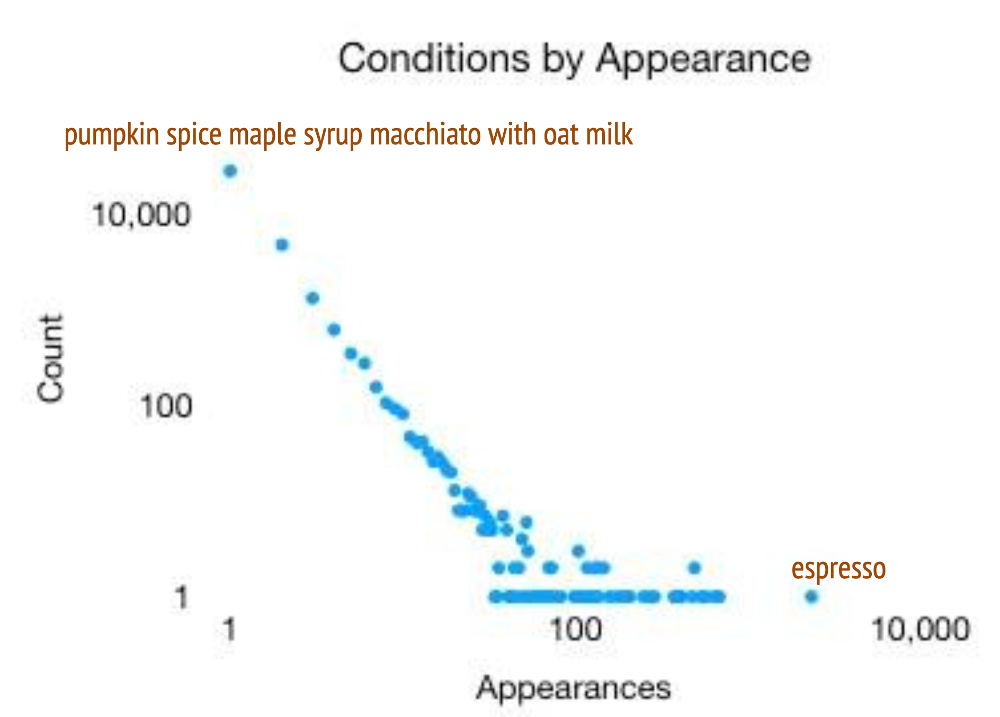

## Books

- Structured Design: <https://vtda.org/books/Computing/Programming/StructuredDesign_EdwardYourdonLarryConstantine.pdf>
- Tidy First: <https://www.oreilly.com/library/view/tidy-first/9781098151232/>

## Feature vs Future

How to match software design with an economic sense? How many things can one economically do next?

Source: <https://newsletter.kentbeck.com/p/mathematicians-heres-a-way-to-think>

Visible vs invisible, how we need invisible work in small chunks. We also need to let people keep investing into our team after all.

⚠ Especially with AI — AI tends to deliver visible Features (<https://newsletter.kentbeck.com/i/216656928/genies-hate-the-invisible>), but without tidy code and expandable architecture, we’re only reducing the amount of future we could deliver — Technical Debt will increase.

### Future: Little tricks down the sleeves

They are small habits like how chefs wipe their knives after every cut. As professional software engineers, we need to have different little tricks ready down our sleeves. We don’t need to use them all the time, but we need to have them ready when needed.

It helps us balance between “Feature: Delivering” and “Future: Addressing Technical Debt”.

Archi-tasks should be small habits. Small jumps, so we don’t need to justify them — then no one would notice.

### Feature: The Art of Waiting

It’s not realistic to make things right the first time. Things are always changing anyways. Just get frequent feedback, a strong feedback loop. Small incrementals, fail fast, learn fast.

💡 How do we judge if we really need to do something (e.g.: a feature, a refactor)?
A: Experience lol

1. Play and experiment with the idea
2. Identify pattern, or have a feeling that there’s just gonna be more, then pull out a little trick from down the sleeve (future)

Just make sure it’s reversible if someone is using it already.

### Survival — balancing strategically

> I honestly don’t remember well — was probably sleepy after lunch :(

The software should survive, meaning we encourage sponsors to invest more “money” into the project. And we do that by delivering features. It increases our Net Present Value.

So less design, more features at the start.

But be careful not to over-investing into a project too early on!

If we want to earn more, we have to pay less.
(e.g.: Delivering more features without minding too much on reusability, duplication, etc. That’s when small habits count! But don’t be afraid to fail and make mistakes.)

We can earn earlier, then pay later.
(e.g.: After getting investment from our sponsors and proving that our features have value, we then have the optionality and can clean up the code)

Like we could use contextProvider right from the start, then we avoid maintaining messy code later as our codebase grow, meaning we have more optionality, more freedom to do other things. But there could also a risk that it’s expensive to maintain without much usage.

🤖 With AI: We’re not learning about our code and the art of software engineering anymore, so our need isn’t met!
(^ Kent’s opinion)

So maybe use AI for experimenting alternatives and learning (optionality), not shipping more code.

## Coupling and Cohesiveness

### Coupling

= Propagation of Change
I.e. Dependency when a change occurs.

“When I change this, what other things need to be changed too?”

⚠ The “Change” event is required to trigger the propagation.

💰 Because it only cost you when you make the change.

Larger size of change === larger cost of change === coupling seriousness.

In Math formula, it will be COUPLE(E1, E2, Delta)

💡 Is our test too coupled right now? Or can we investigate with Graphify?

This concept exists in code: 貧者越貧，富者越富。A condition on the far right are like the top of a tree — many conditions go through there first. Whilst those on the top are like special cases. One needs to pass through many conditions in order to reach there. BUT that doesn’t mean they’re not important!

Source: <https://medium.com/@kentbeck_7670/conditions-are-power-law-distributed-an-example-61fa4e0d3500>

Or, with the coffee analogy from the workshop:

Key takeaways:

- Consolidation candidates / reduce duplication (Where’s our “espresso”? Air pressure, how many grams…)
- Test prioritization: “Which logic, if broken, breaks the most places” it’s like if the espresso is not good, then the latte won’t be good too :( (opinionated)
- 🤖 With AI: What’s the espresso for AI? What’s a micro-structure that AI adopt when writing code? E.g.: comments and tests it generates — are they duplicates?

### Cohesiveness

So the previous one (coupling) is about consolidating separate functions into one. This one is about putting things of the same / similar context into the same place — the same plugin, folder, or even file.

Why? Because when we need to change, there’s less risk that we forget to change other related things.

ContextProvider lol

