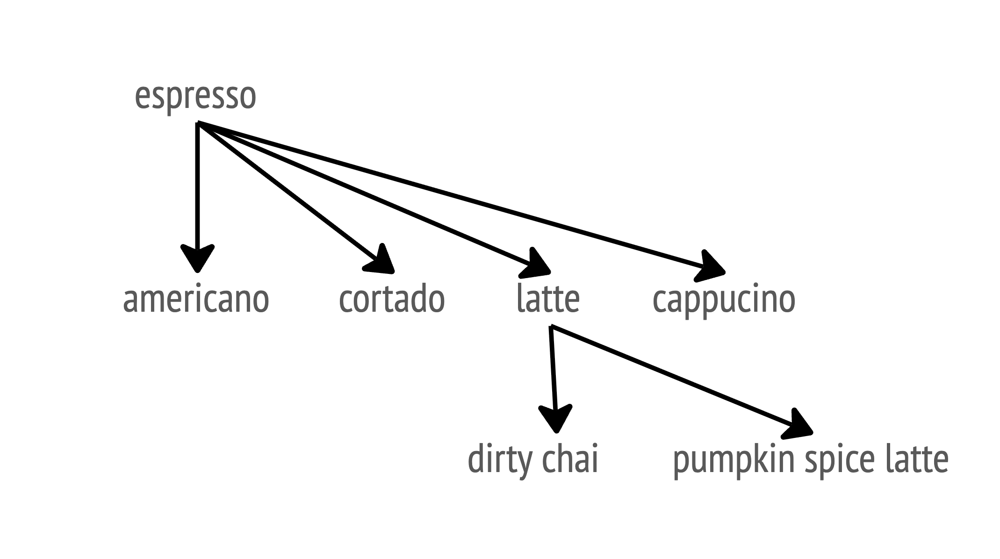

## The money tension

We're always under money pressure: features pay the bills, and sponsors keep investing only if we keep delivering. But the invisible work (tidying, restructuring, keeping the code easy to change) is what keeps us able to experiment and deliver *next* quarter too.

So the question I took away from Kent Beck's "Tidy First" workshop at GOTO 2026 is: **when do we deliver, and when do we do the invisible work?** Being a professional in this area means having the habits and experience to balance both. We should take pride in that.

The notes below build up to an answer in three steps:

1. [What are we balancing?](#what-are-we-balancing): the concepts of features, futures and survival
2. [Where does the cost hide?](#where-does-the-cost-hide): coupling and cohesion
3. [So how do we strike the balance?](#so-how-do-we-strike-the-balance): putting the concepts to work
4. [What does AI change?](#what-does-ai-change)

🤖 marks the places where I tried to connect things to AI. They're collected in the last section.

## What are we balancing?

As geeks, it's easy for us to over-engineer, and that burns through the patience our stakeholders have before they stop investing. But if we ignore good software practices and architectural design, our code will eventually get so smelly that we can no longer add new features.

This is where Kent introduces the concept of "F v F" (Features vs. Futures).

### Features vs. futures

In the chart below, the x-axis is the features we've delivered, and the y-axis is the futures (options) we still have.

Source: <https://newsletter.kentbeck.com/p/mathematicians-heres-a-way-to-think>

The blue line shows what happens when we focus solely on delivering features: every feature moves us right, but eats into our future options, until there's nothing left.

The black line is a more sustainable approach. We balance feature delivery with small spikes of "Future" tasks, such as tidying code and improving the architecture, which forms a sawtooth shape. These tasks are often invisible: they move us up, not right. But those small spikes keep the future of our product open.

Of course, the opposite is also a trap. If we spend all our time doing things right, we keep moving up but never right, and people will stop investing in our team.

So we always have to ask ourselves:

> *How do we match software design with an economic sense? How many things can one economically do next?*

### Survival

The feature we deliver increases our Net Present Value (NPV).
The future we strive for provides *optionality*: keeping our future choices open.

## Where does the cost hide?

So what makes it hard to grow our futures? We need to understand what costs us the most effort and time: the things that are *expensive* to change. Kent gives us two lenses for spotting them, coupling and cohesion.

### Coupling

Coupling is the *propagation of change*, i.e. the dependencies that show up when a change occurs.

“When I change this, what other things need to be changed too?”

In the diagram below, changing the orange node forces changes in the yellow ones. The black nodes aren't affected by this particular change, so they cost us nothing here.

A couple of things to note:

- ⚠ Coupling needs a **change** to trigger the propagation. Two pieces of code can be tangled together, but if we never touch them, nothing propagates.
- 💰 That's why it only costs us when we make the change. Larger size of change === larger cost of change === coupling seriousness.

In math formula, it will be COUPLE(E1, E2, Δ): E1 and E2 are coupled with respect to a change Δ if changing E1 by Δ forces us to change E2.

<!-- TODO: verify the COUPLE definition against Kent's wording -->

> **💡 Opportunity for a workshop:** Is our test too coupled right now? Can we investigate with [Graphify](https://github.com/Graphify-Labs/graphify)?

#### Find your espresso: where to spend effort first

This is my personal summary after digesting what Kent shared on this topic: "espresso" is the kind of element that decides the quality of the drink built on top of it. Just like how we have some conditions in our code that need extra attention to ensure the overall quality and maintainability.

Think of a café menu as code. Each drink's recipe is full of little `if`s: *if it has coffee, pull an espresso shot*, *if it's pumpkin spice, add the syrup*. The drinks are the places in our code, and each of these yes/no questions is a condition. Whatever you order, the barista almost always asks "does it need espresso?" first, so espresso sits at the top of the tree and most drinks depend on it:

This is coupling again. If we change the espresso (say, new beans), every drink that uses it changes too. That's the propagation of change, so the espresso is where a change (or a mistake) costs us the most. The "is it pumpkin spice?" check is the opposite: only one drink has it, so changing it affects just that drink.

So coupling isn't spread evenly across a codebase, and we don't need to treat every line equally. A few elements carry most of the weight.

#### The power law behind it

In code, Kent observed that conditions (`if ...`) are power-law distributed: one condition is used more than any other (like the espresso), a couple are used about half as much, and so on, until there's a long tail of conditions used only once.

On the chart below:

- **x-axis (Appearances):** how many times a condition shows up in the code.
- **y-axis (Count):** how many *different* conditions show up that many times.

So each dot is a group of conditions with the same number of appearances. Top left is a huge crowd of special cases used once; far right is a single condition used over and over.

Source: <https://medium.com/@kentbeck_7670/conditions-are-power-law-distributed-an-example-61fa4e0d3500>

Now map the menu back to the chart. Each check is a condition, and each drink that has it is one appearance:

- **"Needs espresso?":** there's only one espresso check (or a few, in a specialty café), so y (count) is 1. But it appears in drink after drink, so x (appearances) is huge. It's the lone dot on the far right.
- **Flavour checks ("needs pumpkin spice?", "needs caramel syrup?"...):** each appears in just one drink, so x is 1. A menu is full of checks like these, so lots of different conditions land on x = 1, and that's why the dot is way up at the top left.

#### What we can do with this

- **Test the espresso harder.** Ask: "Which logic, if broken, breaks the most places?" If the espresso is not good, the latte won't be good either :( The conditions at the bottom right of the chart are the candidates for the heaviest testing. (opinionated)
- **Consolidate the espresso.** The popular conditions are where duplication hurts most, so they're the best candidates to pull into one place. Where's our "espresso"? Once you find the right air pressure and weight for a type of bean, you'll stick with that configuration consistently.
- **Don't ignore the one-offs.** They're cheap to change, but that doesn't mean they're not important. When it's in season, the pumpkin spice latte is a highlight of the menu and deserves attention too.
- 🤖 **Teach AI on how to spot them.** What's a micro-structure that helps AI recognize repeated patterns when writing tests and generating comments?

### Cohesiveness

Coupling tells us *what changes together*. Cohesiveness is what we do about it: put things of the same / similar context into the same place — the same plugin, folder, or even file.

Why? Because when we need to change, there’s less risk that we forget to change other related things.

Here's an example with a ContextProvider:

On the left, when we change a field value in the side panel, the change has to travel up through the overview tab and back down to Card A to update the value it shows. Every hop in between is a place where we could forget something. On the right, both the change and the update go through a shared ContextProvider, so the related logic lives in one place.

<!-- TODO: add a real example from my own work? -->

### Beneficial Relationships (BRE)

BRE = Beneficial Related Elements, from his *Tidy First* book.

<!-- TODO: expand — what is a "beneficial" relationship vs. a harmful one? -->

### Why are design patterns used?

<!-- TODO: expand — my take: patterns as packaged ways to manage coupling and cohesion? -->

## So how do we strike the balance?

*Scope: using the concepts above to decide what to do, when, and how small.*

### Earn first, pay later

Survival needs both NPV and optionality, so:

**If we want to earn more, we have to pay less.**
(e.g.: Delivering more features without minding too much on reusability, duplication, etc. That’s when small habits count! But don’t be afraid to fail and make mistakes.)

**We can earn earlier, then pay later.**
(e.g.: After getting investment from our sponsors and proving that our features have value, we then have the optionality and can clean up the code)

So less design, more features at the start. But be careful not to over-invest into a project too early on!

Like we could use a ContextProvider right from the start (the cohesion example above), then we avoid maintaining messy code later as our codebase grow, meaning we have more optionality, more freedom to do other things. But there could also a risk that it’s expensive to maintain without much usage.

### The art of waiting

It’s not realistic to make things right the first time. Things are always changing anyways. Just get frequent feedback, a strong feedback loop. Small incrementals, fail fast, learn fast.

💡 How do we judge if we really need to do something (e.g.: a feature, a refactor)?
A: Experience lol

1. Play and experiment with the idea
2. Identify pattern, or have a feeling that there’s just gonna be more, then pull out a little trick from down the sleeve (future)

Just make sure it’s reversible if someone is using it already.

### Little tricks down the sleeves

They are small habits like how chefs wipe their knives after every cut. As professional software engineers, we need to have different little tricks ready down our sleeves. We don’t need to use them all the time, but we need to have them ready when needed.

It helps us balance between “Feature: Delivering” and “Future: Addressing Technical Debt”.

Archi-tasks should be small habits. Small jumps, so we don’t need to justify them — then no one would notice.

### Parallel: migrate without a big bang

It's a technique for migration. If we want to migrate from A to B, we create an "AB" form so that both can coexist at the same time. Then we can gradually update, without a big bang.

### Trade duplication for always-on + safety

<!-- TODO: expand — what exactly is the trade? (duplication in exchange for the old path staying live and safe?) -->

### Tests: cover behavior, not 100%

- Tests should cover *behavioral* changes (BDD?).
- Test coverage doesn't need to be 100%.
- 💡 A thought while listening: maybe we should write it into our spec / instructions / existing code that tests should only test behaviors, and follow the *desiderata*. (Kent Beck's "Test Desiderata" is a list of properties good tests should have, including "behavioral" and "structure-insensitive".)

<!-- TODO: verify the Test Desiderata wording against Kent's post before publishing -->

### Grow software, don't assemble it

"Empirical design": respect constraints. So just work on top of our current code. We can go fast if we understand our constraints.

### Extreme Programming

<!-- TODO: expand — what did Kent say about XP at the workshop? -->

If you're just guessing and asking no users, that's not agile, even though you're doing daily standups!

## What does AI change?

*Scope: how AI sharpens the tension from the start, and what to do about it.*

AI tends to deliver visible Features (<https://newsletter.kentbeck.com/i/216656928/genies-hate-the-invisible>), but without tidy code and expandable architecture, we’re only reducing the amount of future we could deliver — Technical Debt will increase. ⚠

🤖 **We're not learning anymore.** With AI, we’re not learning about our code and the art of software engineering anymore, so our need isn’t met! (^ Kent’s opinion)

🤖 **Use AI for optionality, not just output.** So maybe use AI for experimenting alternatives and learning (optionality), not shipping more code.

🤖 **Document by intent, not implementation.** Maybe this can give us insight on how to use AI more effectively today.

<!-- TODO: expand — what does "documenting by intent" look like in our specs / prompts? -->

🤖 **Tell AI what good tests look like.** Put the "test behaviors, not structure" rule from the testing section into our specs and instructions.

🤖 **Find the espresso.** What’s the espresso for AI-written code? (See the power-law section.)

## Books

- Structured Design: <https://vtda.org/books/Computing/Programming/StructuredDesign_EdwardYourdonLarryConstantine.pdf>
- Tidy First: <https://www.oreilly.com/library/view/tidy-first/9781098151232/>
